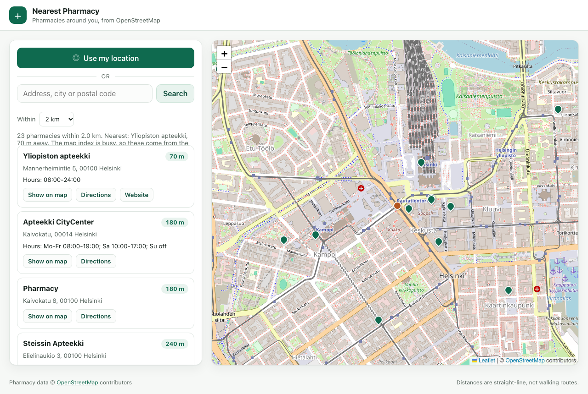

# Nearest Pharmacy — web

Find the pharmacy closest to you, anywhere in the world. A small full-stack app:
a dependency-free Node.js server that talks to OpenStreetMap's Overpass and
Nominatim APIs, and a plain HTML/CSS/JavaScript front end with a Leaflet map.

No build step, no npm dependencies, no API keys. `node server.js` and it runs.



## Run it

```sh
npm start            # http://localhost:3000
npm test             # 23 tests, node:test
```

Requires Node.js 20 or newer (the server uses the built-in `fetch` and
`node:test`).

## How it works

```
browser ──► /api/geocode?q=…     ──► Nominatim  (address → coordinates)
        ──► /api/pharmacies?lat&lon&radius ──► Overpass (pharmacies, full tags)
                                            └► Nominatim (fallback)
```

- **`src/pharmacies.js`** asks Overpass for `amenity=pharmacy` within a radius,
  normalises the tags, filters by true haversine distance, sorts nearest first
  and caches the answer for ten minutes per location.
- **`src/overpass.js`** builds the Overpass QL query and parses the JSON into a
  flat shape (`name`, `address`, `openingHours`, `phone`, `website`,
  `wheelchair`), with a name fallback for unnamed nodes.
- **`src/nominatim.js`** is the fallback when every Overpass instance is busy or
  unreachable: it searches Nominatim's `amenity=pharmacy` index and returns the
  same shape. The response says which source answered (`source` field) and the
  UI tells the user when it had to fall back.
- **`src/geo.js`** holds the pure helpers: WGS84 validation, radius clamping
  (100 m – 20 km), the haversine distance and the stable sort.
- **`public/app.js`** is the browser client: geolocation or address search,
  abortable requests, a Leaflet map with the origin and the pharmacies, a
  result list with distance, opening hours, phone and website, and a shareable
  URL (`?lat=&lon=&radius=`) that survives a reload.

## Decisions worth knowing

- **Two independent data paths.** The public Overpass instances answer with
  `429`/`504` when they are busy, and on some networks they are slow or
  blocked. Rather than fail, the server tries three mirrors and then falls back
  to Nominatim. The tests cover each failure (busy instance, mirror fallback,
  total outage → `503`).
- **Distance is computed, not trusted.** Overpass `around:` is a bounding
  filter around a radius, so every result is re-measured with haversine and the
  list is sorted by that number. The UI says the distances are straight-line.
- **The server is the only thing that talks to the outside.** The front end only
  calls `/api/*`; a strict Content-Security-Policy, `nosniff`,
  `X-Frame-Options: DENY` and a referrer policy are set on every response, and
  static paths are resolved and checked against the public directory so `..`
  cannot escape it.
- **Accessibility.** Semantic landmarks, one `h1`, a hidden `h2` per section,
  `aria-live` status messages in plain language (what happened and what to do
  next), keyboard-reachable results, and `prefers-reduced-motion` respected.
- **No framework.** The whole UI is ~320 lines of vanilla JavaScript; the
  project stays readable for a reviewer and has nothing to install.

## Tests

`npm test` runs 23 tests with `node:test`:

| File | Covers |
|---|---|
| `test/geo.test.js` | coordinate validation, radius clamping, haversine, sort |
| `test/overpass.test.js` | query building, tag parsing, unnamed nodes, mirror fallback, outage |
| `test/nominatim.test.js` | fallback parsing and its failure path |
| `test/server.test.js` | routing, validation errors, method handling, static files, security headers, path traversal |

The network is never touched in tests: every test injects a fake `fetch`.

## Data and licence

Pharmacy data © [OpenStreetMap](https://www.openstreetmap.org/copyright)
contributors, available under the ODbL. Map tiles by OpenStreetMap. The code in
this repository is MIT licensed — see [LICENSE](LICENSE).
